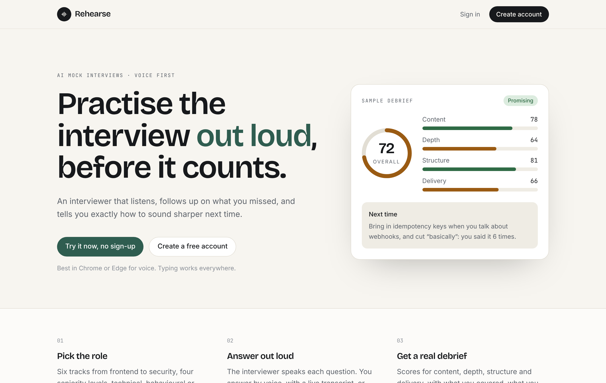
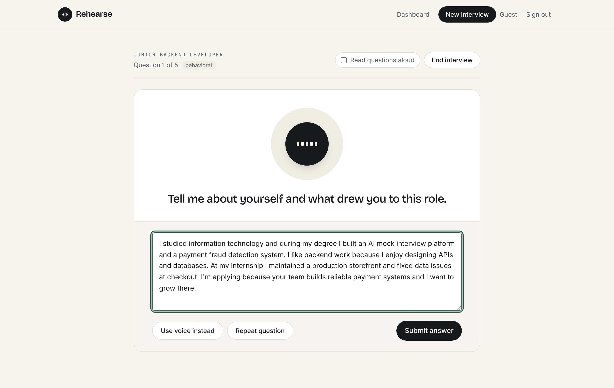
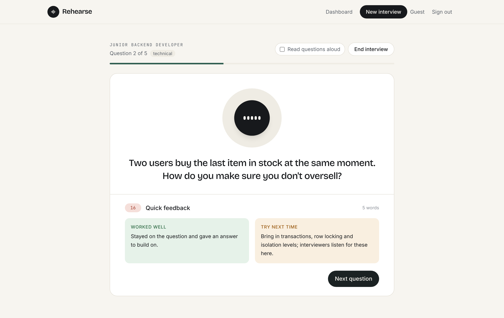
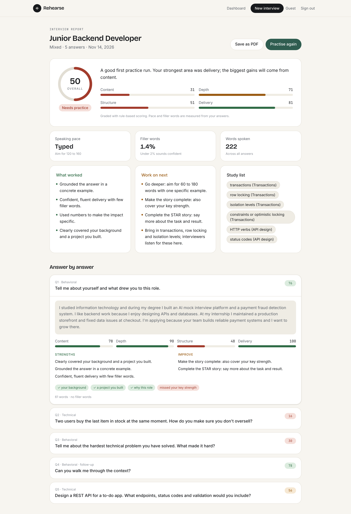
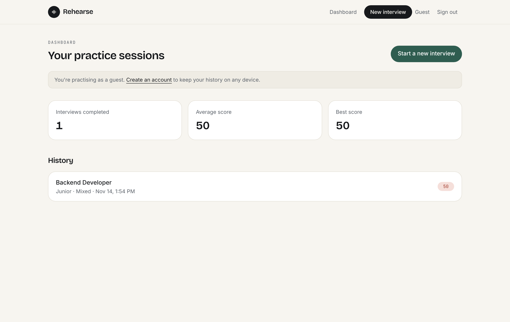
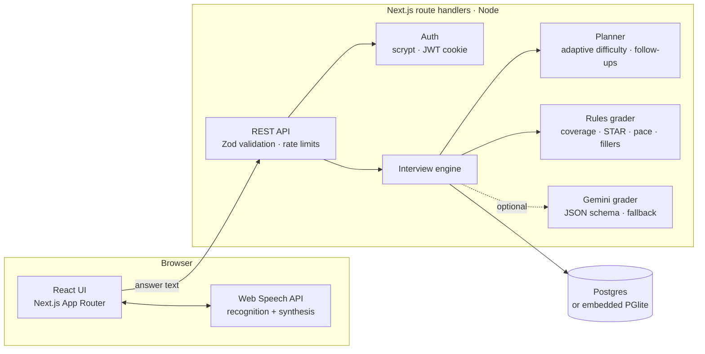

# Rehearse · AI mock interviews

> Built by [Vishwanathan R](https://vishwanathan.dev) · [Portfolio](https://vishwanathan.dev) · [Resume](https://vishwanathan.dev/resume.pdf)

Practise job interviews **out loud**. Rehearse reads each question, listens to your spoken answer, asks follow-ups when you miss something important, and gives you a detailed report with scores for **content, depth, structure and delivery**.

This is version 2, a complete rebuild of my [original AI mock interview platform](https://github.com/Vishwanathanirv/ai_mock_interviews), which was published in the ICRCET-2026 proceedings ([DOI 10.5281/zenodo.24214718](https://doi.org/10.5281/zenodo.24214718)).



## Highlights

- **Voice first, no paid voice API.** Speech recognition and the interviewer's voice run in the browser (Web Speech API). Audio never leaves your device; only the final text is sent. Typing works everywhere as a fallback.
- **Adaptive interviewer.** Difficulty moves up after strong answers and down after weak ones. If you miss a key concept, the interviewer probes it with a follow-up, as a real one would.
- **Measured, not guessed, delivery.** Speaking pace (words per minute), filler words ("um", "basically", "like" as a filler but not as a verb) and hedging are computed from your answer.
- **STAR coaching** for behavioural questions: situation, task, action and result are checked, and missing parts are named.
- **Two grading engines behind one interface.**
  - *Rules*: transparent, deterministic scoring that works with zero configuration.
  - *AI (Gemini)*: grades content, depth and structure with a JSON schema and validates the response with Zod. Delivery stays measured. If the AI call fails or times out, it falls back to the rules engine, so a session never breaks.
- **6 roles × 4 levels × 3 interview types**, with 36 technical and 8 behavioural questions, each with key concepts, synonyms and a follow-up.
- **Progress tracking.** A dashboard with history, average and best scores, and a trend chart. Every answer can be revisited in its report, and reports can be saved as PDF.
- **Secure by default.**
  - scrypt password hashing and signed http-only session cookies (HS256 JWT)
  - per-IP and per-account rate limits, and timing-safe login (no user enumeration)
  - ownership checks on every query, strict security headers, and Zod validation on every input

| Interview room | Instant feedback |
| --- | --- |
|  |  |

| Report | Dashboard |
| --- | --- |
|  |  |

## Architecture



```
src/
  app/                 pages and API route handlers
  components/          Room (voice interview), useVoice hook, charts, forms
  lib/
    interview/         bank, analyzer (rules grader), planner, gemini, service
    auth/              password hashing, session tokens, cookies
    db/                Drizzle schema, Postgres / PGlite connection
tests/
  unit/                analyzer, planner, auth, Gemini adapter (mocked)
  e2e/                 full interview, accounts, access control, validation
```

### How scoring works

Each answer gets four sub-scores from 0 to 100:

| Score | Rules engine | AI engine |
| --- | --- | --- |
| Content | Coverage of the question's key concepts (with synonyms) | Gemini, calibrated to the chosen level |
| Depth | Length sweet spot, plus concrete examples and numbers | Gemini |
| Structure | STAR parts (behavioural) or signposting (technical) | Gemini |
| Delivery | Pace (ideal 120 to 160 wpm), filler rate, hedging | Always measured |

Technical answers weight content most heavily, and behavioural answers weight structure more. The overall interview score gives harder questions more weight.

## Run it locally

You need Node 20+.

```bash
git clone https://github.com/Vishwanathanirv/ai-mock-interviews-v2.git
cd ai-mock-interviews-v2
npm install
npm run dev
```

Open http://localhost:3000 and click **Try it now**. You don't need a database or API key: an embedded Postgres is created in `./.data`.

Optional settings (copy `.env.example` to `.env.local`):

| Variable | Purpose |
| --- | --- |
| `AUTH_SECRET` | Required in production. 32+ random characters (`openssl rand -hex 32`). |
| `DATABASE_URL` | Postgres connection string. Without it, PGlite is used. |
| `GEMINI_API_KEY` | Turns on AI grading, tailored follow-ups and the written debrief. |

Voice answers work in Chrome and Edge. Other browsers use the typing mode automatically.

## Tests

```bash
npm run lint && npm run typecheck
npm test            # 19 unit tests (Vitest)
npm run build
npm run test:e2e    # 4 end-to-end tests (Playwright)
```

GitHub Actions runs all of these on every push.

## Deploy

1. Create a free Postgres database (for example on [Neon](https://neon.tech)).
2. Import the repo into Vercel and set `AUTH_SECRET`, `DATABASE_URL` and, optionally, `GEMINI_API_KEY`.
3. Deploy. Tables are created automatically on first start.

Without `DATABASE_URL`, a Vercel deployment still works, but its data lives in `/tmp` and resets when the server restarts.

## Tech stack

Next.js 15 (App Router) · React 19 · TypeScript · Tailwind CSS 4 · Drizzle ORM · Postgres / PGlite · Zod · jose · Gemini API · Web Speech API · Vitest · Playwright · GitHub Actions

## License

MIT © Vishwanathan R
